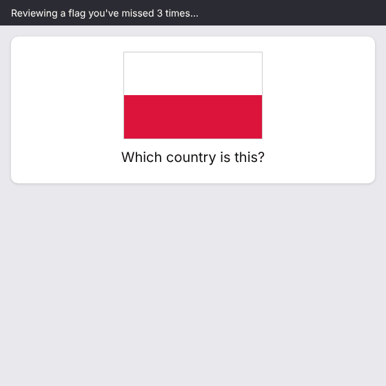

# Flag Mnemonics

An Anki desktop add-on that writes themed mnemonics (Seinfeld by default) for the flag cards you keep forgetting. Each mnemonic encodes what the flag actually looks like and how it differs from its look-alikes, and it's written into the card itself so it syncs to AnkiMobile and AnkiDroid.



Status: feature-complete and in testing. Not on AnkiWeb yet; install it from a `.ankiaddon` file.

## Install

1. **Back up your collection first.** In Anki: File > Export > "Anki Collection Package (.colpkg)", tick "Include media", and keep the file somewhere safe. Also sync, so AnkiWeb has your latest reviews.
2. **Get the add-on file.** Download `flag-mnemonics-ankiaddon` from the latest green [tests run](https://github.com/armita-jamshidi/Elaine/actions/workflows/tests.yml) on `main` (under Artifacts, unzip it), or build it yourself with `python scripts/package.py` (it appears in `dist/`).
3. **Install it.** Double-click `flag_mnemonics-0.1.0.ankiaddon`, or in Anki: Tools > Add-ons > Install from file. Restart Anki.
4. **Add your Claude API key.** Get one at https://console.anthropic.com, then Tools > Add-ons > Flag Mnemonics > Config, and paste it into `claude_api_key`. The key stays on your computer (in the add-on's `meta.json`) and is only sent to Anthropic.
5. **Optional:** change `theme` (any show, book or film you know well), turn on `images_enabled` and add `huggingface_api_key` for pictures. Every setting is explained next to the config.

Needs Anki 23.10 or newer and the [Ultimate Geography](https://github.com/anki-geo/ultimate-geography) deck (any language works; the note type and field names are configurable).

## The first time

Run Tools > "Generate mnemonics for struggling flags". The first time it writes mnemonics onto cards, the add-on asks to add a "Mnemonic" field to the Ultimate Geography note type. That's a structural change, so the next sync is a one-way full sync. The question walks you through it:

1. Sync your phone first.
2. Click Yes.
3. Sync desktop Anki and choose **Upload to AnkiWeb**.
4. Sync your phone and choose **Download from AnkiWeb**.

It saves a copy of the note type before changing it, and it never changes any other field or its content. [docs/PHONE_CHECK.md](docs/PHONE_CHECK.md) has a detailed walkthrough with screenshots.

## The routine

1. **Study on your phone** as usual.
2. **Open desktop Anki every few days and sync.** After the sync, the add-on finds flags you've now missed 3 or more times and writes their mnemonics in the background. You can keep reviewing.
3. **Sync again** (or turn on `auto_sync_after_generation`). The new mnemonics are on your phone.
4. Next time you miss that flag, the 🥨 box is on the back of the card.

On desktop, pressing Again on a flag for the 3rd time writes its mnemonic right away.

## What you can do in Anki

- **Tools > Generate mnemonics for struggling flags**: finds every flag you've forgotten 3+ times that doesn't have a mnemonic yet and writes them, with a progress bar.
- **Tools > Repair mnemonics after deck upgrade**: puts the field, the 🥨 box and every saved mnemonic back. Also runs by itself when Anki starts.
- **Tools > About Flag Mnemonics**: your current settings and how many mnemonics are saved.
- **Browser, right-click on selected flag notes**:
    - *Regenerate mnemonic*: writes a new one, telling Claude the old one didn't stick.
    - *Remove mnemonic*: deletes the saved mnemonic, empties the Mnemonic field and removes the tag. If you keep missing that flag, it gets a fresh one later.
- Every flag with a mnemonic gets the `mnemonic-added` tag, in both storage modes, so you can search for them with `tag:mnemonic-added`.
- **Overlay mode** (`"storage_mode": "overlay"`): shows the same box on desktop at review time without touching the note type. It doesn't reach your phone.
- **Illustrations** (`"images_enabled": true`, off by default): each new mnemonic also gets an original 512×512 picture from [FLUX.1-schnell](https://huggingface.co/black-forest-labs/FLUX.1-schnell) on Hugging Face, drawn from the mnemonic's image prompt. Pictures show objects and places from the joke (a diner booth, a puffy shirt), never people or actors. Needs a Hugging Face token.

Mnemonics are also written automatically after you press Again on a flag for the 3rd time, when Anki starts, and after each sync (so misses on your phone get picked up). After an Ultimate Geography update, the add-on puts back anything the update removed, from its own saved copy (`user_files/mnemonics.json`).

## Cost and privacy

- Each mnemonic is one short Claude request with the flag image, the country name, the deck's look-alike notes, and the mnemonics already written for look-alikes. Nothing else from your collection is sent. Each request is at most a few thousand tokens, so the cost is small; check [Anthropic's pricing](https://www.anthropic.com/pricing) for the model you pick. Only flags you struggle with get a mnemonic, and each one is written once.
- Illustrations send only the picture prompt to Hugging Face.
- Keys are stored in Anki's add-on config on your computer, never in the cards, so they don't sync.

## Credits

- **Deck:** [Ultimate Geography](https://github.com/anki-geo/ultimate-geography) by the anki-geo contributors. The deck is in the public domain; its flag and map images have their own licenses, listed in the deck's `sources.csv`. This add-on doesn't include or redistribute any of them. It reads the flag already in your collection, and the demo GIF draws its flag with CSS.
- **Mnemonics:** written by [Claude](https://www.anthropic.com/claude) (Anthropic) through the Messages API.
- **Illustrations:** [FLUX.1-schnell](https://huggingface.co/black-forest-labs/FLUX.1-schnell) by Black Forest Labs (Apache 2.0), served through [Hugging Face Inference Providers](https://huggingface.co/docs/inference-providers).
- **[Anki](https://apps.ankiweb.net)** by Ankitects (AGPL-3.0), whose add-on hooks make this possible.
- Seinfeld is the default theme only as a memory hook. The add-on isn't affiliated with or endorsed by anyone connected to the show, and it never draws real people.

## Repo layout

```
src/flag_mnemonics/   the add-on (symlink this into a dev Anki, see docs/DEVELOPMENT.md)
  __init__.py         entry point; does nothing outside Anki
  addon.py            Anki wiring: menus and hooks
  settings.py         typed config loading, no Anki imports
  config.json         default settings
  config.md           settings help shown in Anki's config dialog
  triggers.py         finds struggling flag cards (startup, after sync, Again)
  generator.py        prompt, Claude API call (urllib), JSON parsing; stdlib only
  media.py            reads the flag image; renders SVG flags to PNG with Qt
  pipeline.py         runs generation in the background
  storage.py          user_files/mnemonics.json (source of truth) and the Mnemonic field
  display.py          the answer-side mnemonic box and field HTML
  field_mode.py       one-time note type setup, writing to cards, repair, sync reminder
  overlay.py          overlay mode: adds the box at review time, desktop only
  browser_actions.py  Browser right-click: Regenerate / Remove mnemonic
  images.py           optional illustrations (FLUX.1-schnell via Hugging Face); stdlib only
tests/                pytest, with Anki mocked (plus tests on a real Anki backend)
scripts/link_dev.py   symlinks the add-on into a dev Anki data folder
scripts/sample_mnemonics.py   generates sample mnemonics outside Anki
scripts/package.py    builds dist/flag_mnemonics-<version>.ankiaddon
scripts/make_demo_gif.py      renders docs/images/demo.gif with the add-on's own box
docs/DEVELOPMENT.md   dev setup, test profile, Python version
docs/PHONE_CHECK.md   checking a mnemonic on AnkiMobile or AnkiDroid
```

## Why no Anthropic SDK?

Anki add-ons can't `pip install` packages, so `generator.py` calls the Claude Messages API with Python's built-in `urllib`. It has no third-party or Anki imports, which also lets the Hugging Face Space demo reuse it unchanged.

## Developing

See [docs/DEVELOPMENT.md](docs/DEVELOPMENT.md). Short version: back up your collection, run Anki with a separate data folder (`-b ~/AnkiDev`), `python scripts/link_dev.py ~/AnkiDev`, then `pytest`. To release: bump `human_version` in `manifest.json`, then `python scripts/package.py`. It refuses to build if `config.json` contains a key or has mock mode on.
