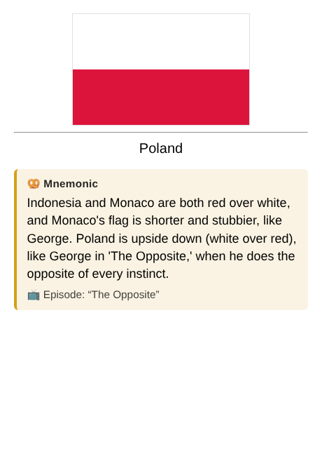

# Flag Mnemonics

An Anki desktop add-on that writes themed mnemonics (Seinfeld by default) for the flag cards you keep forgetting. Each mnemonic encodes what the flag actually looks like and how it differs from its look-alikes, and it's written into the card itself so it syncs to AnkiMobile and AnkiDroid.

Status: early development (stage 6 of 10: writes mnemonics with Claude, puts them on your flag cards so they sync to your phone, repairs them after a deck upgrade, and has the menu and Browser actions below).

## What you can do in Anki

- **Tools > Generate mnemonics for struggling flags**: finds every flag you've forgotten 3+ times that doesn't have a mnemonic yet and writes them, with a progress bar.
- **Tools > Repair mnemonics after deck upgrade**: puts the field, the 🥨 box and every saved mnemonic back. Also runs by itself when Anki starts.
- **Tools > About Flag Mnemonics**: your current settings and how many mnemonics are saved.
- **Browser, right-click on selected flag notes**:
    - *Regenerate mnemonic*: writes a new one, telling Claude the old one didn't stick.
    - *Remove mnemonic*: deletes the saved mnemonic, empties the Mnemonic field and removes the tag. If you keep missing that flag, it gets a fresh one later.
- Every flag with a mnemonic gets the `mnemonic-added` tag, in both storage modes, so you can search for them with `tag:mnemonic-added`.
- **Overlay mode** (`"storage_mode": "overlay"`): shows the same box on desktop at review time without touching the note type. It doesn't reach your phone.

Mnemonics are also written automatically after you press Again on a flag for the 3rd time, when Anki starts, and after each sync (so misses on your phone get picked up).



## Repo layout

```
src/flag_mnemonics/   the add-on (symlink this into a dev Anki, see docs/DEVELOPMENT.md)
  __init__.py         entry point; does nothing outside Anki
  addon.py            Anki wiring: menus and hooks
  settings.py         typed config loading, no Anki imports
  config.json         default settings
  config.md           settings help shown in Anki's config dialog
  triggers.py         finds struggling flag cards (startup, after sync, Again)
  generator.py        prompt, Claude API call (urllib), JSON parsing; stdlib only
  media.py            reads the flag image; renders SVG flags to PNG with Qt
  pipeline.py         runs generation in the background
  storage.py          user_files/mnemonics.json (source of truth) and the Mnemonic field
  display.py          the answer-side mnemonic box and field HTML
  field_mode.py       one-time note type setup, writing to cards, repair, sync reminder
  overlay.py          overlay mode: adds the box at review time, desktop only
  browser_actions.py  Browser right-click: Regenerate / Remove mnemonic
  images.py           later stage
tests/                pytest, with Anki mocked (plus tests on a real Anki backend)
scripts/link_dev.py   symlinks the add-on into a dev Anki data folder
scripts/sample_mnemonics.py   generates sample mnemonics outside Anki
docs/DEVELOPMENT.md   dev setup, test profile, Python version
docs/PHONE_CHECK.md   checking a mnemonic on AnkiMobile or AnkiDroid
```

## Why no Anthropic SDK?

Anki add-ons can't `pip install` packages, so `generator.py` calls the Claude Messages API with Python's built-in `urllib`. It has no third-party or Anki imports, which also lets the Hugging Face Space demo reuse it unchanged.

## Developing

See [docs/DEVELOPMENT.md](docs/DEVELOPMENT.md). Short version: back up your collection, run Anki with a separate data folder (`-b ~/AnkiDev`), `python scripts/link_dev.py ~/AnkiDev`, then `pytest`.
