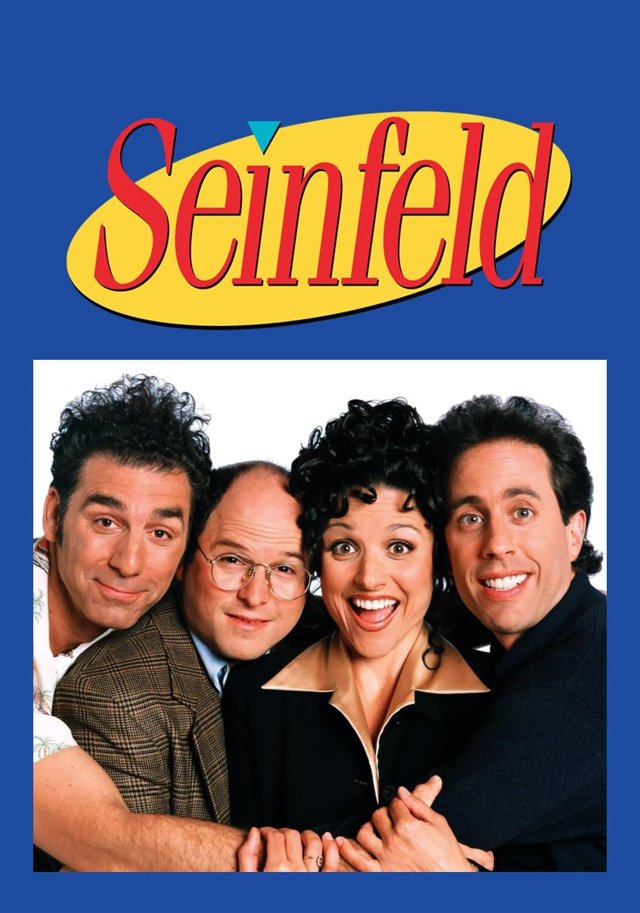
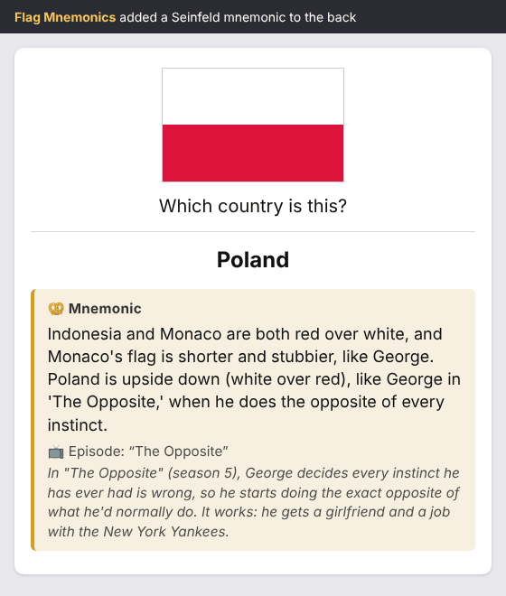
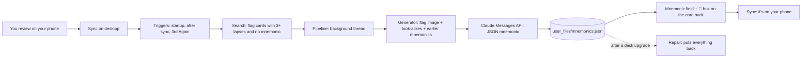

# Elaine: Flag Mnemonics for Anki

<p align="center">
  
  <br>
  <sub>Seinfeld promotional image &copy; Castle Rock Entertainment. Used here as a nod to the theme; this project isn't affiliated with the show.</sub>
</p>

<h1 align="center"><a href="https://ankiweb.net/shared/info/1050900423">👉 Try it out on AnkiWeb</a></h1>

<p align="center">In Anki: <b>Tools &gt; Add-ons &gt; Get Add-ons</b>, then paste the code <code>1050900423</code>.</p>

<p align="center"><i>Keep mixing up Poland, Indonesia and Monaco? So did George. Elaine writes you a Seinfeld joke about it.</i></p>


Elaine is an Anki desktop add-on for the [Ultimate Geography](https://github.com/anki-geo/ultimate-geography) deck. When you've forgotten a flag card 3 or more times, it asks Claude for a short Seinfeld-themed mnemonic that encodes what the flag actually looks like and how it differs from its look-alikes, plus a plain explanation of the episode it references, for anyone who hasn't seen the show. The mnemonic is written into the card itself, so it syncs to AnkiMobile and AnkiDroid. The theme is a setting: any show, book or film you know well works.

## What it looks like

<p align="center">
  
</p>

The 🥨 box sits on the back of the card only, so it never gives the answer away. It's hidden on cards that don't have a mnemonic, and it reads in light and dark mode on desktop and phone.

## How It Works



1. **Find.** After each sync, when Anki starts, and when you press Again on a flag for the 3rd time, the add-on searches for flag cards with 3 or more lapses that don't have the `mnemonic-added` tag yet.
2. **Write.** For each one, Claude gets the flag image, the country, the deck's own "Flag similarity" notes, and the mnemonics already written for look-alike flags, so two similar flags never get similar jokes. It replies with a mnemonic, the episode title, a plain explanation of that episode, the one visual detail that sets the flag apart, and an image prompt.
3. **Save.** Every mnemonic is saved first to `user_files/mnemonics.json`, the add-on's source of truth, and then written into a "Mnemonic" field on the note with the `mnemonic-added` tag.
4. **Show.** A small box at the end of the card's back template shows the mnemonic, the 📺 episode and the explanation.
5. **Sync.** On the next sync it reaches your phone. Miss the flag again, and the joke is right there.

## The Technical Bits, Explained

### Prompting Claude to be funny and accurate

The hard part isn't making Claude write a joke. It's making the joke help you picture *this exact flag*. The system prompt has seven rules, and each one fixes a failure I'd expect from a model left to itself:

| Rule | What it prevents |
| --- | --- |
| **Encode the flag itself** | A funny line that doesn't help you tell Poland from Indonesia. Colors, their order, layout and the difference from look-alikes must be in the joke. |
| **No made-up episodes** | Invented plots. A specific episode must come with its exact title in `episode_title` so it can be checked; if Claude isn't sure, it uses a character trait instead. |
| **Use your own words** | Quoting the show. A nod to a famous line is fine, more than a few words of dialogue isn't. |
| **Avoid confusion with other flags** | Two look-alikes sharing a gag. Claude sees existing mnemonics (look-alikes first, up to 30) and must make the contrast the point. |
| **One to three sentences** | Paragraph-long mnemonics. Longer replies are kept but logged with a warning. |
| **Explain the reference** | Jokes that only fans get. A `context` line says what happens in the episode, in plain words. |
| **Theme** | Lock-in to one show. The theme is a single setting. |

The prompt ends with one hand-written example (the Poland mnemonic above), because a concrete example of "names the look-alikes, says exactly how they differ" does more than any rule.

### Using the Claude API from inside Anki

- **No SDK.** Anki add-ons can't `pip install` packages, so `generator.py` calls the Messages API with Python's built-in `urllib`. A test fails if it ever imports anything outside the standard library.
- **Structured outputs.** The reply must match a JSON schema (`mnemonic`, `episode_title`, `context`, `distinguishing_detail`, `image_prompt`), so there's no fragile text parsing.
- **Vision.** The flag image is sent with the request, so Claude looks at the real flag rather than its memory of it.
- **Prompt caching.** The long system prompt is marked cacheable, so a batch of flags pays for it once.
- **Server-side fallback.** If a safety classifier declines a harmless request, the API re-runs it on a fallback model instead of failing the batch.
- **Retries and clear errors.** 429 and 5xx responses are retried. A missing or rejected key, a refusal, a cut-off reply or bad JSON each gets its own message.
- **Regenerate.** In the Browser, right-click a flag and choose *Regenerate mnemonic*. Claude is told the old one didn't stick and to use a different scene.

### Optional illustrations

With `images_enabled` on, each mnemonic also gets an original 512×512 picture from [FLUX.1-schnell](https://huggingface.co/black-forest-labs/FLUX.1-schnell) through Hugging Face Inference Providers. A style suffix on every prompt forbids people, faces, actors, likenesses, text and logos, so pictures only ever show objects and places from the joke (a diner booth, a puffy shirt). A failed picture never loses a mnemonic.

## Architecture

- **Never freeze Anki.** Notes are read on the main thread, then every API call runs in a background `QueryOp` that doesn't hold the collection, so you can keep reviewing and syncing while it writes. Writes to cards go back through a `CollectionOp` on the main thread.
- **A JSON file is the source of truth, not the cards.** `user_files/mnemonics.json` is keyed by note ID and also stores each note's GUID. Writes are atomic, and a damaged file is never overwritten. Anki keeps `user_files/` across add-on updates, so nothing is lost when you upgrade.
- **Change as little of your deck as possible.** The add-on appends one field and one block to the end of the back template, between marker comments, and nothing else. It backs up the note type first and never touches other fields, front templates or CSS. The box uses inline styles so it doesn't depend on the deck's CSS.
- **Ask before a full sync.** Adding a field is a schema change, which forces a one-way full sync. The add-on asks first and tells you the safe order: sync your phone, click Yes, upload from desktop, download on your phone.
- **Two storage modes.** Field mode (the default) writes onto the card so it reaches your phone. Overlay mode adds the same box at review time on desktop, with no note type changes at all.
- **Self-repair.** On startup it checks the field, the box, and every saved mnemonic and tag, and puts back whatever a deck upgrade removed.
- **Anki-free core.** `settings.py`, `generator.py` and `images.py` import nothing from Anki, so they're easy to test, and a small local Gradio demo in `space/` uses a copy of the same prompt (a test keeps the two identical).

```
src/flag_mnemonics/
  __init__.py         entry point; does nothing outside Anki
  addon.py            Anki wiring: menus and hooks
  settings.py         typed config loading, no Anki imports
  config.json         default settings (config.md explains each one)
  triggers.py         finds struggling flag cards (startup, after sync, Again)
  generator.py        prompt, Claude API call (urllib), JSON parsing; stdlib only
  media.py            reads the flag image; renders SVG flags to PNG with Qt
  pipeline.py         runs generation in the background
  storage.py          user_files/mnemonics.json and the Mnemonic field
  display.py          the answer-side 🥨 box
  field_mode.py       one-time note type setup, writing to cards, repair
  overlay.py          overlay mode: adds the box at review time, desktop only
  browser_actions.py  Browser right-click: Regenerate / Remove mnemonic
  images.py           optional illustrations (FLUX.1-schnell); stdlib only
tests/                pytest, with Anki mocked, plus tests on a real Anki backend
scripts/              dev linking, sample mnemonics, packaging, demo GIF
docs/                 DEVELOPMENT.md, PHONE_CHECK.md, ANKIWEB.md
space/                a local Gradio demo with a copy of generator.py
```

## Debugging Stories

**The flags Claude couldn't see.** Ultimate Geography stores its flags as SVG files, and Claude's vision input doesn't accept SVG. Sending the raw files would have meant Claude never actually looked at the flag. The fix uses something every Anki install already has: Qt. `media.py` renders each SVG to a PNG with Qt before it's sent, and if Qt isn't available, the SVG source goes as text instead, since the source still describes the stripes and colors. I checked the rendering on the real Ultimate Geography SVGs for Poland, Indonesia, Monaco, Chad and Romania.

**The deck upgrade that erased everything.** Upgrading Ultimate Geography with CrowdAnki resets its templates and CSS, can drop extra fields (with their content), and can rewrite tags. Every mnemonic on the cards would be gone. That's why `mnemonics.json` is the source of truth: on startup, a repair step compares the cards with the saved copy and rebuilds what's missing. Re-adding the box is silent, but re-adding the field asks first, because it means another full sync. Notes that come back with a new ID are matched by their GUID. I tested it by simulating upgrades on a real Anki collection: full reset, template-only, tags-only, re-created notes and deleted notes.

**The template that would have looked outdated.** When overlay mode needed the same box as field mode, I moved the HTML into one shared function. But the add-on decides whether a card's template is up to date by looking for the exact snippet it would write now. Any change to the output, even whitespace, would have made every installed template look outdated and get rewritten on the next startup. So the refactor keeps the snippet byte-for-byte identical.

**Six stages that never reached `main`.** The add-on was built in ten stacked pull requests, each based on the one before it. PRs #4 to #10 were merged into their parent stage branches instead of `main`, so `main` was quietly missing Stages 5 to 10 even though every PR showed as merged. PR #11 was based on the last stage branch, so merging it brought all of them into `main` at once.

**More bugs caught along the way:**

- **The sentence counter that couldn't read titles.** The "three sentences or fewer" check split on periods, so `'The Opposite.'` inside a mnemonic counted as an extra sentence. It now ignores quoted titles before counting.
- **Never delete the wrong picture.** Regenerating or removing a mnemonic trashes its old illustration. To make sure that can never touch your own media, only files named `flagmnem_*` are ever deleted.
- **No keys in a release.** `meta.json`, where Anki saves your config with your API key, sits right next to the add-on code. `package.py` leaves it out, and refuses to build at all if `config.json` contains a key or has mock mode on.

## What I Learned

- **Anki's add-on API:** hooks for sync, startup and review, `QueryOp` and `CollectionOp` for background work, the Browser context menu, and what counts as a schema change.
- **The Claude API without an SDK:** raw HTTP requests, vision input, structured outputs, prompt caching, retries, refusals and server-side fallback.
- **Prompt design for creative but accurate writing:** rules that each target a failure, a strong example, context from earlier outputs, and a field (`episode_title`) that makes made-up facts checkable.
- **Designing for other people's data:** a separate source of truth, atomic writes, backups before every structural change, and asking before anything that forces a full sync.
- **Testing a desktop plugin:** mocking `aqt`, running the same tests on a real Anki collection, rendering screenshots in a headless browser, and CI on the two Python versions Anki supports.
- **Shipping:** reproducible `.ankiaddon` builds, AnkiWeb listing and versioning, and credits and licenses for every source.
- **Building with an AI coding agent:** working with Claude Code in small staged pull requests, tracked in Notion, and learning to check where stacked PRs actually land.

## Tech Stack

| Area | Technology |
| --- | --- |
| Language | Python 3.10+ (Anki ships 3.13) |
| Host app | Anki desktop 23.10 to 26.9: `aqt` hooks, `QueryOp`, `CollectionOp`, Qt for SVG rendering |
| LLM | Anthropic Claude Messages API over `urllib`: vision, structured outputs, prompt caching, server-side fallback |
| Images (optional) | FLUX.1-schnell via Hugging Face Inference Providers |
| Storage | JSON file in the add-on's `user_files/`, plus a Mnemonic field on the note |
| Testing | pytest with Anki mocked, plus tests on the real `anki` backend; GitHub Actions on Python 3.10 and 3.13 |
| Packaging | `scripts/package.py` (reproducible `.ankiaddon`), published on AnkiWeb |
| Content | [Ultimate Geography](https://github.com/anki-geo/ultimate-geography) deck |
| Development tools | Claude Code, Git and GitHub pull requests, Notion for task tracking |

## Quick Start

### Use it

1. **Back up your collection.** File > Export > "Anki Collection Package (.colpkg)", with "Include media" ticked. Also sync, so AnkiWeb has your latest reviews.
2. **Install.** Tools > Add-ons > Get Add-ons, paste `1050900423`, click OK, and restart Anki. ([AnkiWeb page](https://ankiweb.net/shared/info/1050900423))
3. **Add your Claude API key.** Get one at https://console.anthropic.com, then Tools > Add-ons > Flag Mnemonics > Config, and paste it into `claude_api_key`. The key stays on your computer and is only sent to Anthropic.
4. **Run it once.** Tools > "Generate mnemonics for struggling flags". The first time, it asks to add the Mnemonic field. Follow its steps: sync your phone, click Yes, sync desktop and choose **Upload to AnkiWeb**, then sync your phone and choose **Download from AnkiWeb**.
5. **Then just study.** Open desktop Anki every few days and sync. New mnemonics are written in the background, and the next sync takes them to your phone.

Needs Anki 23.10 or newer and the Ultimate Geography deck (any language; the note type and field names are configurable). [docs/PHONE_CHECK.md](docs/PHONE_CHECK.md) walks through checking a mnemonic on your phone.

**Handy extras:** in the Browser, right-click flags to *Regenerate* or *Remove* a mnemonic; search `tag:mnemonic-added` to see them all; Tools > "Repair mnemonics after deck upgrade" puts everything back after an Ultimate Geography update.

**Cost and privacy:** each mnemonic is one short Claude request with the flag image, the country name, the deck's look-alike notes and earlier mnemonics. Nothing else from your collection is sent, and each flag gets a mnemonic once. Keys live in Anki's add-on config on your computer, never on cards, so they don't sync.

### Develop it

```bash
git clone https://github.com/armita-jamshidi/yada-yada-flags && cd yada-yada-flags
python -m venv .venv && source .venv/bin/activate
pip install -r requirements-dev.txt
pytest                                   # Anki-backend tests run when `anki` is installed
python scripts/link_dev.py ~/AnkiDev     # symlink into a separate Anki data folder (anki -b ~/AnkiDev)
python scripts/package.py                # builds dist/flag_mnemonics-<version>.ankiaddon
```

Set `use_mock_api` to `true` to try everything without a key. [docs/DEVELOPMENT.md](docs/DEVELOPMENT.md) has the full setup, including how to fake lapses and simulate a deck upgrade.

## Credits

- **Deck:** [Ultimate Geography](https://github.com/anki-geo/ultimate-geography) by the anki-geo contributors. The deck is in the public domain; its flag and map images have their own licenses, listed in the deck's `sources.csv`. This add-on doesn't include or redistribute any of them. It reads the flag already in your collection.
- **Mnemonics:** written by [Claude](https://www.anthropic.com/claude) (Anthropic) through the Messages API.
- **Illustrations:** [FLUX.1-schnell](https://huggingface.co/black-forest-labs/FLUX.1-schnell) by Black Forest Labs (Apache 2.0), through [Hugging Face Inference Providers](https://huggingface.co/docs/inference-providers).
- **[Anki](https://apps.ankiweb.net)** by Ankitects (AGPL-3.0), whose add-on hooks make this possible.
- **Seinfeld** is the default theme only as a memory hook, and the cover image above is the show's promotional art. The add-on isn't affiliated with or endorsed by anyone connected to the show, and it never draws real people.
