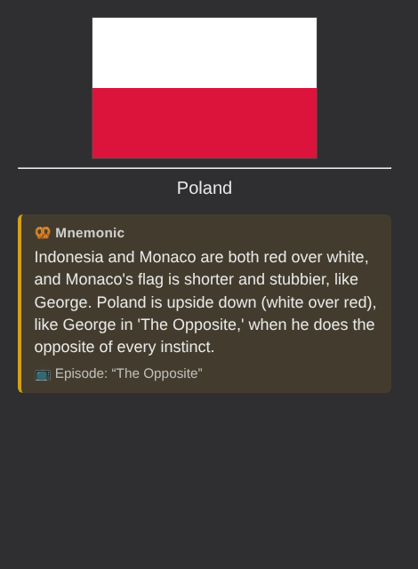

# Checking a mnemonic on your phone

Field mode writes each mnemonic into a "Mnemonic" field and adds a small box to the back of your flag cards. Both travel with normal AnkiWeb sync, so AnkiMobile and AnkiDroid show them without any add-on.

| Light | Dark |
| --- | --- |
|  |  |

The box uses inline styles with translucent colors, so it follows whatever light or dark background the app uses and needs no changes to the deck's styling.

## The one-time full sync

Adding the Mnemonic field changes the note type's structure, which Anki calls a schema change. The first sync after it has to be a full, one-way sync. The add-on asks before doing it, and this only happens once (and again only if a deck upgrade removes the field; see the last item below).

## Walkthrough

You can't do this from the dev copy, because it must stay signed out of your real AnkiWeb account. Do it on your real profile once you're happy with the mnemonics in the dev copy.

1. **Back up.** In desktop Anki: File > Export > "Anki Collection Package (.colpkg)", tick "Include media", save it somewhere safe.
2. **Sync your phone,** so AnkiWeb has every review you've done.
3. **Sync desktop Anki,** so it has them too.
4. **Install the add-on in your real Anki:** build it with `python scripts/package.py`, double-click `dist/flag_mnemonics-0.1.0.ankiaddon` (or Tools > Add-ons > Install from file), add your Claude key in its config, and restart Anki.
5. **Generate.** Tools > "Generate mnemonics for struggling flags". When it asks to add the Mnemonic field, read the steps it shows and click Yes.
6. **Sync desktop Anki.** Anki says a one-way sync is needed. Choose **Upload to AnkiWeb**.
7. **Sync your phone.** It says the same. Choose **Download from AnkiWeb**.
8. **Find the card.** On the phone, open Browse and search `tag:mnemonic-added`. Open one of the flag cards, preview it, and show the answer. The "🥨 Mnemonic" box should appear under the country name, with the episode title if there is one and a short line explaining what happens in it.
9. **Check dark mode.** Switch the phone (or the app) to dark mode and look at the same card. The text should stay readable and the box should be a dim gold instead of cream.
10. **Check the other cards.** The front of the flag card and the capital and map cards should look exactly as before.

From then on it's routine: study on your phone, open desktop Anki every few days so it can catch up on flags you've missed, then sync. New mnemonics arrive with the next normal sync; only the very first one needs the full sync.

## If something looks wrong

- **No box on the answer side:** check the card is a "Flag - Country" card (or whatever is in `flag_card_templates`), and that the note's Mnemonic field isn't empty in the desktop Browser.
- **The box shows on the front:** it shouldn't. The snippet is only added to back templates. Please tell me which app and card type.
- **The field or box disappeared after a deck update:** open desktop Anki. On startup the add-on notices and offers to repair it, restoring every mnemonic from its saved copy. You can also run Tools > "Repair mnemonics after deck upgrade". If it had to re-add the field, the next sync is a full sync again: follow the same steps as above.
